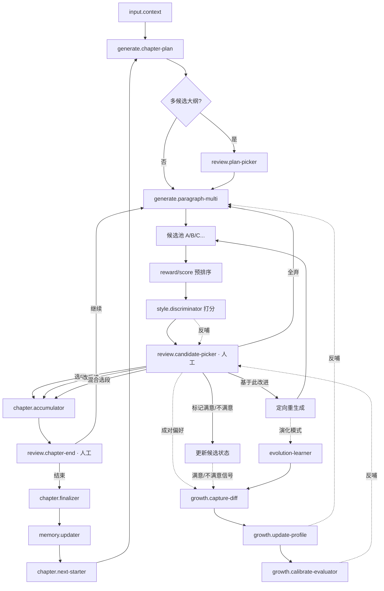

我无法直接生成可下载的文件链接，但下面是一份**完整、可直接复制保存为 `SPEC.md` 的最终版文档**。你只需把下面内容全选复制，粘贴到编辑器里保存为 `SPEC.md` 即可。

---

```markdown
# SPEC.md · NovelForge

**成长型小说生成桌面软件 · 完整规格**

---

## 0. 给 Agent 的元指令

- 本文档是**唯一事实来源**。实现时若与文档冲突，以文档为准。
- 每个模块都有 **路径 / 职责 / 导出接口 / 依赖 / 验收标准**，按此实现。
- 优先实现 Phase 1，再迭代。**不要跳阶段**。
- 所有跨进程通信必须走本文定义的协议，**不允许绕过**。
- 类型定义先写，再写实现。所有接口先写 mock，再写真实实现。
- 若发现规格问题，在 `SPEC-CHANGELOG.md` 记录，**不要改本文**。

---

## 1. 需求总览

### 1.1 产品定位

一个**桌面端小说生成工具**，核心不是"让 AI 写小说"，而是：

- **ComfyUI 式拖拽工作流**：节点可自由编排。
- **逐段生成、逐段确认**：每段可选"直接添加"或"修改后添加"，然后继续下一段。
- **章节边界由用户手动决定**：什么时候结束当前章、进入下一章，用户说了算。
- **多候选选唯一 + 候选可演化**：
  - 每段生成 N 个候选，用户最终选一个。
  - **每个候选可独立标记"满意/不满意"**，不满意可附理由。
  - **可基于任意候选定向重新生成**：不满意某个候选时，以它为起点改进，而不是全弃重来。
  - 满意的候选可锁定，作为后续生成的"基线"。
  - 候选之间存在**谱系关系**（父候选 → 子候选），系统学习"从 X 到 Y 的改进模式"。
- **AI 根据用户选择学习成长**：选中的、淘汰的、修改的、满意/不满意的，都变成训练信号，越用越懂用户。
- **作家风格模仿**：支持导入某作家的**任意数量作品**（1 本、5 本、10 本、20 本均可），系统根据作品数量自动选择分析策略，从作品集合中提取风格指纹、风格报告和 RAG 库，生成时模仿该风格。

### 1.2 硬约束

| 约束 | 值 |
|---|---|
| 技术栈 | Node.js + Python + TypeScript |
| 形态 | 桌面软件（Electron） |
| 模型 | Ollama（本地） |
| 数据库 | SQLite + sqlite-vec |
| 工作流 | ComfyUI 风格拖拽 |

### 1.3 非目标

- 不做云端 SaaS。
- 不做移动端。
- 不做多人协作。
- 不硬编码任何作品数量、章节长度、候选数。

---

## 2. 系统拓扑与进程模型

```
┌─────────────────────────────────────────────────────────────┐
│  Electron Renderer (React + TS)                             │
│  - UI：节点画布、候选面板、风格库、成长仪表盘                  │
│  - 状态：Zustand                                            │
│  - 画布：React Flow                                         │
└──────────────────────┬──────────────────────────────────────┘
                       │ Channel A: Electron IPC
┌──────────────────────▼──────────────────────────────────────┐
│  Electron Main (Node.js + TS)                               │
│  - Workflow Engine                                          │
│  - Node Registry                                            │
│  - Data Layer (SQLite)                                      │
│  - LLM Gateway (Ollama)                                     │
│  - Python Sidecar Manager                                   │
│  - Growth System                                            │
└──────────────────────┬──────────────────────────────────────┘
                       │ Channel B: HTTP + SSE (localhost)
┌──────────────────────▼──────────────────────────────────────┐
│  Python Sidecar (FastAPI + Uvicorn)                         │
│  - Style Analyzer                                           │
│  - Embedding Service                                        │
│  - RAG Service                                              │
│  - Style Discriminator                                      │
│  - Reward Model                                             │
│  - LoRA Inference（Phase 3+）                               │
└─────────────────────────────────────────────────────────────┘
                       │ Channel C: HTTP
┌─────────────────────────────────────────────────────────────┐
│  Ollama (localhost:11434)                                   │
└─────────────────────────────────────────────────────────────┘
```

**进程启动顺序**：

```
1. Main 启动
   a. 初始化 SQLite（WAL 模式）
   b. OllamaLifecycle.ensureRunning()
      - 成功 → 继续
      - 失败 → 弹窗提示用户安装 Ollama，提供下载链接
   c. 检查所需模型是否已拉取
      - 缺失 → 显示拉取进度条（可跳过）
   d. 启动 Python Sidecar
   e. 等 Sidecar health check
2. 创建 BrowserWindow
3. Renderer 加载
```

**Python Sidecar 生命周期**：

- 由 Main 用 `child_process.spawn` 启动。
- 端口从 0 动态分配，Main 读 stdout 首行 JSON 拿到端口。
- Main 退出时 kill 子进程。
- 崩溃自动重启（最多 3 次）。

---

## 3. 目录结构

```
novel-forge/
├── package.json
├── tsconfig.json
├── electron-builder.yml
├── apps/
│   ├── main/
│   │   ├── src/
│   │   │   ├── index.ts
│   │   │   ├── ipc/{index,project,workflow,candidate,style,growth}.ts
│   │   │   ├── workflow/{engine,graph,executor,pauser,types}.ts
│   │   │   ├── nodes/
│   │   │   │   ├── registry.ts
│   │   │   │   ├── input/
│   │   │   │   ├── context/
│   │   │   │   ├── generate/
│   │   │   │   ├── review/
│   │   │   │   ├── chapter/
│   │   │   │   ├── growth/
│   │   │   │   └── style/
│   │   │   ├── db/{index.ts,migrations/,repositories/}
│   │   │   ├── llm/
│   │   │   │   ├── gateway.ts
│   │   │   │   ├── providers/ollama.ts
│   │   │   │   ├── model-router.ts
│   │   │   │   ├── ollama-lifecycle.ts
│   │   │   │   └── vram-monitor.ts
│   │   │   ├── sidecar/{manager.ts,client.ts}
│   │   │   └── growth/
│   │   │       ├── preference.ts
│   │   │       ├── reward.ts
│   │   │       ├── prompt-evolver.ts
│   │   │       ├── fewshot.ts
│   │   │       └── evolution-learner.ts
│   │   └── package.json
│   ├── renderer/
│   │   ├── src/
│   │   │   ├── main.tsx
│   │   │   ├── App.tsx
│   │   │   ├── stores/
│   │   │   ├── ipc/
│   │   │   ├── components/
│   │   │   │   ├── canvas/
│   │   │   │   ├── nodes/
│   │   │   │   ├── candidate-panel/
│   │   │   │   ├── style-library/
│   │   │   │   ├── growth-dashboard/
│   │   │   │   └── editor/
│   │   │   └── styles/
│   │   └── package.json
│   └── shared/
│       └── src/{types/,schemas/,constants.ts}
├── sidecar/
│   ├── pyproject.toml
│   ├── src/novel_forge_sidecar/
│   │   ├── main.py
│   │   ├── api/{health,style,embed,rag,discriminator,reward,scene}.py
│   │   ├── services/
│   │   │   ├── style_analyzer.py
│   │   │   ├── stylometry.py
│   │   │   ├── scene_tagger.py
│   │   │   ├── embedder.py
│   │   │   ├── vector_store.py
│   │   │   ├── discriminator.py
│   │   │   └── reward_model.py
│   │   ├── models/
│   │   └── utils/
│   └── tests/
└── resources/
    ├── migrations/
    └── default-workflows/
```

---

## 4. 通信协议

### 4.1 Channel A · Renderer ↔ Main（Electron IPC）

**命名规范**：`<domain>:<action>`。

**频道清单**：

| Channel | Req | Res |
|---|---|---|
| `project:create` | ProjectCreateReq | ProjectCreateRes |
| `project:get` | ProjectGetReq | ProjectGetRes |
| `workflow:load` | WorkflowLoadReq | WorkflowLoadRes |
| `workflow:run` | WorkflowRunReq | WorkflowRunRes |
| `workflow:pause` | WorkflowPauseReq | WorkflowPauseRes |
| `workflow:resume` | WorkflowResumeReq | WorkflowResumeRes |
| `workflow:stop` | WorkflowStopReq | WorkflowStopRes |
| `candidate:list` | CandidateListReq | CandidateListRes |
| `candidate:select` | CandidateSelectReq | CandidateSelectRes |
| `candidate:reject-all` | CandidateRejectAllReq | CandidateRejectAllRes |
| `candidate:satisfy` | `{ runId, nodeId, candidateId }` | `{ ok }` |
| `candidate:dissatisfy` | `{ runId, nodeId, candidateId, reason?, reasonTags? }` | `{ ok }` |
| `candidate:unmark` | `{ runId, nodeId, candidateId }` | `{ ok }` |
| `candidate:regenerate-from` | `{ runId, nodeId, candidateId, mode, hint? }` | `{ newCandidateIds }` |
| `candidate:regenerate-similar` | `{ runId, nodeId, candidateId, count }` | `{ newCandidateIds }` |
| `candidate:prune-unsatisfied` | `{ runId, nodeId }` | `{ removed }` |
| `style:import` | StyleImportReq | StyleImportRes |
| `style:get` | StyleGetReq | StyleGetRes |
| `growth:stats` | GrowthStatsReq | GrowthStatsRes |

**流式事件**（Main → Renderer）：

```ts
type StreamEvent =
  | { type: 'workflow:node-start'; runId: string; nodeId: string }
  | { type: 'workflow:node-token'; runId: string; nodeId: string; token: string }
  | { type: 'workflow:node-paused'; runId: string; nodeId: string; payload: unknown }
  | { type: 'workflow:node-done'; runId: string; nodeId: string; output: unknown }
  | { type: 'workflow:node-error'; runId: string; nodeId: string; error: string }
  | { type: 'candidate:marked'; runId: string; candidateId: string; satisfaction: Satisfaction }
  | { type: 'candidate:generated'; runId: string; nodeId: string; candidate: Candidate }
  | { type: 'candidate:pruned'; runId: string; removedIds: string[] }
  | { type: 'style:import-progress'; jobId: string; stage: string; progress: number }
  | { type: 'growth:updated'; projectId: string; stats: GrowthStats };
```

### 4.2 Channel B · Main ↔ Python Sidecar（HTTP + SSE）

```
GET  /health                              → { status, version }
POST /style/analyze                        → SSE 流式进度
GET  /style/{styleId}                      → StyleProfile
DELETE /style/{styleId}                    → { ok }
POST /embed                                → { vectors }
POST /rag/index                            → { ok, count }
POST /rag/query                            → { results }
POST /discriminator/score                  → { score, verdict }
POST /reward/score                         → { scores }
POST /reward/train                         → SSE 流式进度
POST /lora/infer                           → SSE 流式
POST /scene/classify                       → { sceneType, confidence }
```

### 4.3 Channel C · Main ↔ Ollama

**全部走原生 API**，不走 OpenAI 兼容端点。

| 维度 | 原生 `/api/chat` | OpenAI 兼容 `/v1` |
|---|---|---|
| 结构化输出 | `format` 支持 JSON Schema | 支持不完整 |
| keep_alive 控制 | 原生参数 | 不暴露 |
| 模型管理 | `/api/pull` `/api/delete` `/api/ps` | 不提供 |
| Embedding | `/api/embed` 原生批量 | 兼容性有限 |

---

## 5. 数据模型

### 5.1 SQLite Schema

```sql
-- 001_init.sql
PRAGMA journal_mode = WAL;
PRAGMA synchronous = NORMAL;
PRAGMA busy_timeout = 5000;
PRAGMA foreign_keys = ON;

CREATE TABLE schema_migrations (
  version TEXT PRIMARY KEY,
  applied_at INTEGER NOT NULL
);

CREATE TABLE projects (
  id TEXT PRIMARY KEY,
  name TEXT NOT NULL,
  genre TEXT NOT NULL,
  description TEXT,
  created_at INTEGER NOT NULL,
  updated_at INTEGER NOT NULL
);

CREATE TABLE chapters (
  id TEXT PRIMARY KEY,
  project_id TEXT NOT NULL REFERENCES projects(id),
  idx INTEGER NOT NULL,
  title TEXT NOT NULL,
  status TEXT NOT NULL,     -- planned|writing|draft|final
  word_count INTEGER DEFAULT 0,
  summary TEXT,
  created_at INTEGER NOT NULL,
  updated_at INTEGER NOT NULL
);

CREATE TABLE paragraphs (
  id TEXT PRIMARY KEY,
  chapter_id TEXT NOT NULL REFERENCES chapters(id),
  idx INTEGER NOT NULL,
  text TEXT NOT NULL,
  scene_type TEXT NOT NULL,
  metadata TEXT,            -- JSON
  created_at INTEGER NOT NULL
);

CREATE TABLE workflows (
  id TEXT PRIMARY KEY,
  project_id TEXT NOT NULL REFERENCES projects(id),
  name TEXT NOT NULL,
  graph TEXT NOT NULL,      -- JSON: { nodes, edges }
  version INTEGER NOT NULL,
  updated_at INTEGER NOT NULL
);

CREATE TABLE runs (
  id TEXT PRIMARY KEY,
  workflow_id TEXT NOT NULL REFERENCES workflows(id),
  status TEXT NOT NULL,     -- running|paused|done|error
  current_node_id TEXT,
  state TEXT,               -- JSON
  created_at INTEGER NOT NULL,
  updated_at INTEGER NOT NULL
);

CREATE TABLE candidates (
  id TEXT PRIMARY KEY,
  run_id TEXT NOT NULL REFERENCES runs(id),
  node_id TEXT NOT NULL,
  idx INTEGER NOT NULL,
  text TEXT NOT NULL,
  strategy TEXT NOT NULL,           -- JSON
  scores TEXT NOT NULL,             -- JSON
  satisfaction TEXT NOT NULL DEFAULT 'unrated',   -- satisfied|unsatisfied|unrated
  satisfaction_reason TEXT,
  satisfaction_tags TEXT,           -- JSON array
  parent_candidate_id TEXT REFERENCES candidates(id),
  generation_mode TEXT NOT NULL DEFAULT 'fresh',
  generation_depth INTEGER NOT NULL DEFAULT 0,
  lineage TEXT,                     -- JSON array of ids
  marked_at INTEGER,
  selected INTEGER DEFAULT 0
);

CREATE INDEX idx_candidates_parent ON candidates(parent_candidate_id);
CREATE INDEX idx_candidates_satisfaction ON candidates(run_id, satisfaction);

CREATE TABLE candidate_lineage (
  id TEXT PRIMARY KEY,
  parent_id TEXT NOT NULL REFERENCES candidates(id),
  child_ids TEXT NOT NULL,          -- JSON array
  mode TEXT NOT NULL,               -- improve|variant
  hint TEXT,
  created_at INTEGER NOT NULL
);

CREATE TABLE evolution_patterns (
  id TEXT PRIMARY KEY,
  project_id TEXT NOT NULL,
  parent_text TEXT NOT NULL,
  child_text TEXT,
  child_texts TEXT,                 -- JSON array（全部落选时）
  mode TEXT NOT NULL,
  hint TEXT,
  outcome TEXT,                     -- selected|rejected
  diff TEXT,                        -- JSON: 语义 diff
  created_at INTEGER NOT NULL
);

CREATE TABLE satisfaction_tags (
  id TEXT PRIMARY KEY,
  project_id TEXT NOT NULL,
  tag TEXT NOT NULL,
  polarity TEXT NOT NULL,           -- positive|negative
  count INTEGER NOT NULL DEFAULT 0,
  updated_at INTEGER NOT NULL
);

CREATE INDEX idx_tags_project ON satisfaction_tags(project_id, polarity);

CREATE TABLE styles (
  id TEXT PRIMARY KEY,
  author_name TEXT NOT NULL,
  genre TEXT NOT NULL,
  book_count INTEGER NOT NULL,
  fingerprint TEXT NOT NULL,        -- JSON
  report TEXT NOT NULL,             -- JSON
  created_at INTEGER NOT NULL,
  updated_at INTEGER NOT NULL
);

CREATE TABLE style_books (
  id TEXT PRIMARY KEY,
  style_id TEXT NOT NULL REFERENCES styles(id),
  title TEXT NOT NULL,
  word_count INTEGER,
  chapter_count INTEGER,
  path TEXT
);

CREATE TABLE rag_chunks (
  id TEXT PRIMARY KEY,
  style_id TEXT NOT NULL REFERENCES styles(id),
  book_id TEXT NOT NULL,
  chapter_index INTEGER,
  text TEXT NOT NULL,
  scene_type TEXT NOT NULL,
  vector BLOB                       -- float32 array
);

CREATE INDEX idx_rag_style_scene ON rag_chunks(style_id, scene_type);

CREATE TABLE preference_samples (
  id TEXT PRIMARY KEY,
  project_id TEXT NOT NULL,
  style_id TEXT,
  context TEXT NOT NULL,
  chosen TEXT NOT NULL,
  rejected TEXT NOT NULL,
  reasons TEXT,                     -- JSON array
  created_at INTEGER NOT NULL
);

CREATE INDEX idx_pref_project ON preference_samples(project_id, created_at);

CREATE TABLE growth_stats (
  project_id TEXT PRIMARY KEY REFERENCES projects(id),
  stats TEXT NOT NULL,              -- JSON
  updated_at INTEGER NOT NULL
);

CREATE TABLE prompt_versions (
  id TEXT PRIMARY KEY,
  project_id TEXT NOT NULL,
  node_type TEXT NOT NULL,
  version INTEGER NOT NULL,
  content TEXT NOT NULL,
  metrics TEXT,                     -- JSON
  created_at INTEGER NOT NULL
);
```

### 5.2 并发方案

Node 和 Python 双进程访问同一 SQLite 文件：

- **WAL 模式**：读写不互斥。
- **写入分工**：
  - Node 写：`projects`, `chapters`, `paragraphs`, `workflows`, `runs`, `candidates`, `candidate_lineage`, `evolution_patterns`, `satisfaction_tags`, `preference_samples`, `growth_stats`, `prompt_versions`
  - Python 写：`styles`, `style_books`, `rag_chunks`
  - 双方**只读**对方写的表。
- **busy_timeout**：写冲突等 5 秒。

### 5.3 不存 DB 的数据

| 数据 | 存储 |
|---|---|
| 原始导入作品 | 文件系统 `data/books/` |
| 导出成稿 | 文件系统 `data/exports/` |
| 风格报告 markdown | 文件系统 `data/styles/{styleId}/report.md` |
| 模型缓存（LoRA、判别器） | 文件系统 `data/models/` |
| 日志 | 文件系统 `logs/` |
| Ollama 模型 | Ollama 自管 `~/.ollama/` |

DB 里只存**路径引用**。

### 5.4 迁移与备份

- **迁移**：Node 用 `umzug`，Python 用 `alembic`。迁移前强制备份。
- **自动备份**：每天首次启动备份到 `data/backups/YYYY-MM-DD.db`。
- **手动备份**：设置面板一键导出。

---

## 6. TypeScript 类型定义

### 6.1 project.ts

```ts
export interface Project {
  id: string;
  name: string;
  genre: string;
  description?: string;
  createdAt: number;
  updatedAt: number;
}

export interface Chapter {
  id: string;
  projectId: string;
  index: number;
  title: string;
  status: 'planned' | 'writing' | 'draft' | 'final';
  wordCount: number;
  summary?: string;
  createdAt: number;
  updatedAt: number;
}

export interface Paragraph {
  id: string;
  chapterId: string;
  index: number;
  text: string;
  sceneType: SceneType;
  metadata: ParagraphMetadata;
}
```

### 6.2 workflow.ts

```ts
export interface Workflow {
  id: string;
  projectId: string;
  name: string;
  nodes: WorkflowNode[];
  edges: WorkflowEdge[];
  version: number;
}

export interface WorkflowNode {
  id: string;
  type: NodeType;
  position: { x: number; y: number };
  params: Record<string, unknown>;
}

export interface WorkflowEdge {
  id: string;
  source: { nodeId: string; port: string };
  target: { nodeId: string; port: string };
  condition?: { port: string; equals: unknown };
}

export type NodeType =
  | 'input.context' | 'input.manual'
  | 'context.memory' | 'context.style'
  | 'generate.chapter-plan' | 'generate.paragraph-multi'
  | 'generate.dialogue' | 'generate.polish'
  | 'review.candidate-picker' | 'review.chapter-end'
  | 'chapter.accumulator' | 'chapter.finalizer' | 'chapter.next-starter'
  | 'memory.updater'
  | 'growth.capture-diff' | 'growth.update-profile' | 'growth.calibrate-evaluator'
  | 'style.rag-retrieve' | 'style.discriminator';
```

### 6.3 candidate.ts

```ts
export interface Candidate {
  id: string;
  runId: string;
  nodeId: string;
  index: number;
  text: string;
  strategy: CandidateStrategy;
  scores: CandidateScores;

  satisfaction: Satisfaction;
  satisfactionReason?: string;
  satisfactionTags?: string[];
  parentCandidateId?: string;
  generationMode: GenerationMode;
  generationDepth: number;
  lineage: string[];
}

export type Satisfaction = 'satisfied' | 'unsatisfied' | 'unrated';
export type GenerationMode = 'fresh' | 'improve' | 'variant' | 'mix';

export interface CandidateStrategy {
  label: string;
  temperature: number;
  perspective?: string;
  pacing?: string;
  dialogueRatio?: string;
}

export interface CandidateScores {
  pacing: number;
  character: number;
  consistency: number;
  profileFit: number;
  styleSimilarity: number;
  rewardScore: number;
}

export type UserAction =
  | { type: 'select'; candidateId: string; editedText?: string }
  | { type: 'mix'; sources: { candidateId: string; span: [number, number] }[] }
  | { type: 'satisfy'; candidateId: string }
  | { type: 'dissatisfy'; candidateId: string; reason?: string; reasonTags?: string[] }
  | { type: 'unmark'; candidateId: string }
  | { type: 'regenerate-from'; candidateId: string; mode: 'improve' | 'variant'; hint?: string }
  | { type: 'regenerate-similar'; candidateId: string; count: number }
  | { type: 'reject-all'; reason?: string }
  | { type: 'add-candidates'; count: number }
  | { type: 'prune-unsatisfied' };
```

### 6.4 style.ts

```ts
export interface StyleProfile {
  id: string;
  authorName: string;
  genre: string;
  bookCount: number;
  books: StyleBook[];
  fingerprint: StyleFingerprint;
  report: StyleReport;
  ragStats: { totalChunks: number; byScene: Record<SceneType, number> };
  discriminatorVersion?: string;
  rewardModelVersion?: string;
  createdAt: number;
  updatedAt: number;
}

export interface StyleFingerprint {
  avgSentenceLength: number;
  sentenceLengthStd: number;
  shortSentenceRatio: number;
  avgParagraphLength: number;
  dialogueRatio: number;
  metaphorDensity: number;
  punctuation: Record<string, number>;
  topWords: string[];
  signatureWords: string[];
  forbiddenWords: string[];
}

export type SceneType =
  | 'battle' | 'dialogue' | 'daily' | 'psychology'
  | 'environment' | 'transition' | 'hook' | 'climax';
```

### 6.5 growth.ts

```ts
export interface PreferenceSample {
  id: string;
  projectId: string;
  styleId?: string;
  context: string;
  chosen: string;
  rejected: string;
  reasons: string[];
  createdAt: number;
}

export interface GrowthStats {
  growthIndex: number;
  preference: {
    totalSamples: number;
    reasonCoverage: number;
    dimensions: Record<string, number>;
  };
  candidate: {
    topPickRate: number;
    avgCandidateCount: number;
    rejectAllRate: number;
  };
  satisfaction: {
    totalMarked: number;
    satisfiedRate: number;
    unsatisfiedRate: number;
    topNegativeTags: { tag: string; count: number }[];
    topPositiveTags: { tag: string; count: number }[];
    avgGenerationDepth: number;
    convergenceRate: number;
  };
  model: {
    rewardVersion: number;
    rewardAccuracy: number;
    evaluatorAlignment: number;
  };
  style: {
    avgSimilarity: number;
    discriminatorScore: number;
  };
}
```

### 6.6 RunState

```ts
interface RunState {
  runId: string;
  workflowId: string;
  status: 'running' | 'paused' | 'done' | 'error';
  currentNodeId?: string;
  outputs: Record<string, Record<string, unknown>>;
  context: {
    projectId: string;
    chapterId?: string;
    styleId?: string;
    accumulatedParagraphs: string[];
    [key: string]: unknown;
  };
}
```

---

## 7. 核心模块规格

### 7.1 Workflow Engine（`apps/main/src/workflow/`）

**职责**：执行 DAG，支持循环、暂停、流式输出、状态持久化。

**接口**：

```ts
export class WorkflowEngine {
  constructor(registry: NodeRegistry, db: Database, eventBus: EventBus);

  start(params: { projectId: string; workflowId: string; fromNodeId?: string }): Promise<{ runId: string }>;
  resume(params: { runId: string; nodeId: string; userAction: UserAction }): Promise<void>;
  stop(runId: string): Promise<void>;
  getRun(runId: string): RunState | undefined;
}
```

**执行算法**：

```
1. 加载 workflow graph
2. 拓扑排序，找起始节点（无入边）
3. 执行节点：
   a. 收集输入端口数据
   b. registry.get(node.type).execute(ctx, inputs)
   c. 流式事件通过 eventBus 发到 Renderer
   d. 输出写入 RunState.outputs[nodeId]
4. 若节点是人工节点（pause=true）：
   a. 持久化 RunState（status=paused）
   b. 发 'workflow:node-paused'
   c. 等 resume()
5. 若节点多出边：
   a. 根据输出端口决定走哪条（条件分支）
   b. 支持循环：出边指回上游节点则继续
6. 无出边时，run 标记 done
```

**验收标准**：
- 能跑通 5 节点线性 DAG
- 能在人工节点暂停，resume 后继续
- 能处理循环（段落生成 → 审阅 → 累加 → 回生成）
- 进程崩溃后能恢复 paused 状态

### 7.2 Node Registry

```ts
export interface NodeDefinition<In = any, Out = any> {
  type: NodeType;
  title: string;
  inputs: PortSpec[];
  outputs: PortSpec[];
  params: ParamSpec[];
  pause?: boolean;
  execute(ctx: NodeContext, input: In): Promise<Out> | AsyncGenerator<Out>;
}

export interface NodeContext {
  runId: string;
  nodeId: string;
  projectId: string;
  db: Database;
  llm: LLMGateway;
  sidecar: SidecarClient;
  emit: (event: StreamEvent) => void;
  log: (msg: string) => void;
}
```

### 7.3 节点清单

| type | 输入 | 输出 | pause | 依赖 |
|---|---|---|---|---|
| `input.context` | 无 | `context` | 否 | DB |
| `input.manual` | 无 | `text` | 否 | — |
| `context.memory` | `context` | `memory` | 否 | DB + Sidecar |
| `context.style` | `context` | `stylePrompt` | 否 | DB |
| `generate.chapter-plan` | `context`, `memory` | `plan` | 否 | LLM |
| `generate.paragraph-multi` | `plan`, `memory`, `stylePrompt` | `candidates[]` | 否 | LLM + Sidecar |
| `generate.dialogue` | `context` | `text` | 否 | LLM |
| `generate.polish` | `text` | `text` | 否 | LLM |
| `review.candidate-picker` | `candidates[]` | `selected` | **是** | — |
| `review.chapter-end` | `chapterDraft` | `decision` | **是** | — |
| `chapter.accumulator` | `selected` | `chapterDraft` | 否 | DB |
| `chapter.finalizer` | `chapterDraft` | `finalChapter`, `memoryUpdate` | 否 | LLM + DB |
| `chapter.next-starter` | `memory` | `context` | 否 | — |
| `memory.updater` | `memoryUpdate` | `memory` | 否 | DB |
| `growth.capture-diff` | `selected` | `signal` | 否 | DB |
| `growth.update-profile` | `signal` | `profile` | 否 | DB |
| `growth.calibrate-evaluator` | `signal` | `calibration` | 否 | DB |
| `style.rag-retrieve` | `plan` | `fewshot[]` | 否 | Sidecar |
| `style.discriminator` | `candidates[]` | `scored[]` | 否 | Sidecar |

### 7.4 LLM Gateway

```ts
export class LLMGateway {
  registerProvider(name: string, provider: LLMProvider): void;
  setDefault(name: string): void;
  chat(req: ChatRequest & { provider?: string }): AsyncGenerator<ChatChunk>;
  embed(texts: string[]): Promise<number[][]>;
}

export interface ChatRequest {
  model: string;
  messages: { role: 'system' | 'user' | 'assistant'; content: string }[];
  temperature?: number;
  maxTokens?: number;
  stop?: string[];
  format?: 'json' | object;
  topP?: number;
  topK?: number;
}
```

### 7.5 Ollama Provider

```ts
import { Ollama } from 'ollama';

export class OllamaProvider implements LLMProvider {
  name = 'ollama';
  private client: Ollama;
  private defaultKeepAlive: string;

  constructor(config: { host?: string; keepAlive?: string }) {
    this.client = new Ollama({ host: config.host ?? 'http://localhost:11434' });
    this.defaultKeepAlive = config.keepAlive ?? '30m';
  }

  async *chat(req: ChatRequest): AsyncGenerator<ChatChunk> {
    const stream = await this.client.chat({
      model: req.model,
      messages: req.messages,
      stream: true,
      keep_alive: this.defaultKeepAlive,
      format: req.format,
      options: {
        temperature: req.temperature ?? 0.7,
        num_predict: req.maxTokens,
        stop: req.stop,
        top_p: req.topP,
        top_k: req.topK,
      },
    });

    for await (const chunk of stream) {
      yield {
        delta: chunk.message.content,
        finishReason: chunk.done ? 'stop' : undefined,
      };
    }
  }

  async embed(texts: string[], model?: string): Promise<number[][]> {
    const res = await this.client.embed({
      model: model ?? 'nomic-embed-text',
      input: texts,
    });
    return res.embeddings;
  }

  async listModels(): Promise<OllamaModel[]> {
    return (await this.client.list()).models;
  }

  async pullModel(name: string): Promise<AsyncGenerator<PullProgress>> {
    return this.client.pull({ model: name, stream: true });
  }

  async deleteModel(name: string): Promise<void> {
    await this.client.delete({ model: name });
  }

  async showModel(name: string): Promise<ModelInfo> {
    return this.client.show({ model: name });
  }
}
```

### 7.6 Ollama Lifecycle

```ts
export class OllamaLifecycle {
  constructor(private config: { host: string; autoStart: boolean }) {}

  async ensureRunning(): Promise<{ status: 'running' | 'started' | 'failed' }>;
  async isHealthy(): Promise<boolean>;
  async ensureModel(name: string): Promise<boolean>;
  async pullModel(name: string, onProgress: (p: PullProgress) => void): Promise<void>;
  async getVramUsage(): Promise<VramInfo>;
}
```

### 7.7 结构化输出（Zod → JSON Schema）

```ts
import { z } from 'zod';
import { zodToJsonSchema } from 'zod-to-json-schema';

export const ChapterPlanSchema = z.object({
  title: z.string(),
  goal: z.string(),
  conflict: z.string(),
  hook: z.string(),
  estimatedParagraphs: z.number().int().min(3).max(30),
  keyBeats: z.array(z.string()),
});

export const ParagraphCandidatesSchema = z.object({
  candidates: z.array(z.object({
    text: z.string(),
    strategy: z.enum(['稳健', '平衡', '冒险']),
    pacing: z.number().min(0).max(1),
  })).min(1).max(7),
});

export function toOllamaFormat<T extends z.ZodType>(schema: T) {
  return zodToJsonSchema(schema, { target: 'openApi3' });
}
```

**注意**：结构化输出节点温度设为 0。Zod 必须锁定 3.x（4.x 与 Ollama 不兼容）。

### 7.8 模型路由

```ts
export interface ModelRoute {
  task: 'chapter-plan' | 'paragraph-gen' | 'polish'
      | 'style-analyze' | 'discriminator' | 'embedding';
  model: string;
  temperature: number;
  format?: 'json' | object;
}

export const DEFAULT_ROUTES: ModelRoute[] = [
  { task: 'chapter-plan',  model: 'qwen3:8b',         temperature: 0 },
  { task: 'paragraph-gen', model: 'qwen3:8b',         temperature: 0.7 },
  { task: 'polish',        model: 'qwen3:8b',         temperature: 0.3 },
  { task: 'style-analyze', model: 'qwen3:32b',        temperature: 0 },
  { task: 'discriminator', model: 'qwen3:8b',         temperature: 0 },
  { task: 'embedding',     model: 'nomic-embed-text', temperature: 0 },
];
```

### 7.9 性能配置

```ts
export const OLLAMA_CONFIG = {
  keepAlive: '30m',
  keepAliveBatch: '-1',
  numCtx: 8192,
  numCtxAnalysis: 32768,
  numParallel: 3,
} as const;
```

多候选并行时 `OLLAMA_NUM_PARALLEL` 设为候选数，否则请求串行排队。

---

## 8. Python Sidecar 规格

### 8.1 依赖

```toml
[project]
dependencies = [
    "fastapi>=0.115",
    "uvicorn[standard]>=0.32",
    "ollama>=0.4",
    "sentence-transformers>=3.0",
    "sqlite-vec>=0.1",
    "numpy>=1.26",
    "pydantic>=2.9",
    "pypdf>=5.0",
    "beautifulsoup4>=4.12",
    "lxml>=5.0",
]
```

### 8.2 Embedder

```python
from ollama import AsyncClient

class OllamaEmbedder:
    def __init__(self, host="http://localhost:11434",
                 model="nomic-embed-text", batch_size=32):
        self.client = AsyncClient(host=host)
        self.model = model
        self.batch_size = batch_size

    async def encode(self, texts: list[str]) -> list[list[float]]:
        all_vectors = []
        for i in range(0, len(texts), self.batch_size):
            batch = texts[i:i + self.batch_size]
            res = await self.client.embed(model=self.model, input=batch)
            all_vectors.extend(res.embeddings)
        return all_vectors
```

### 8.3 Vector Store（sqlite-vec）

```python
import struct

def vector_to_blob(vec: list[float]) -> bytes:
    return struct.pack(f'{len(vec)}f', *vec)

def blob_to_vector(blob: bytes) -> list[float]:
    n = len(blob) // 4
    return list(struct.unpack(f'{n}f', blob))

class VectorStore:
    def upsert(self, style_id: str, chunks: list[RagChunk],
               vectors: list[list[float]]) -> None: ...
    def query(self, style_id: str, query_vector: list[float],
              scene_type: SceneType | None, top_k: int) -> list[RagChunk]: ...
```

### 8.4 Style Analyzer

**输入**：作家名 + **N 本书**（N ≥ 1，动态）
**输出**：StyleProfile + 报告 + RAG 库

**流水线**：

```python
async def analyze(author_name: str, books: list[BookInput]) -> AsyncIterator[Progress]:
    # Stage 1: 结构化
    yield Progress("chunking", 0.0)
    chapters = []
    for book in books:
        chapters.extend(split_chapters(book.path))
    yield Progress("chunking", 1.0)

    # Stage 2: 清洗
    yield Progress("cleaning", 0.0)
    chapters = [c for c in (clean(c) for c in chapters) if quality_check(c)]
    yield Progress("cleaning", 1.0)

    # Stage 3: 场景标注
    yield Progress("tagging", 0.0)
    for i, c in enumerate(chapters):
        for p in c.paragraphs:
            p.scene_type = scene_classifier(p.text)
        yield Progress("tagging", (i + 1) / len(chapters))
    yield Progress("tagging", 1.0)

    # Stage 4: 统计特征
    yield Progress("stylometry", 0.0)
    fingerprint = compute_stylometry(chapters)
    yield Progress("stylometry", 1.0)

    # Stage 5: LLM 深度分析
    yield Progress("llm-analysis", 0.0)
    report = await llm_analyze(chapters, sample_size=select_sample_size(len(chapters)))
    yield Progress("llm-analysis", 1.0)

    # Stage 6: Embedding + 入库
    yield Progress("embedding", 0.0)
    chunks = build_rag_chunks(chapters, fingerprint)
    vectors = await embedder.encode([c.text for c in chunks])
    vector_store.upsert(style_id, chunks, vectors)
    yield Progress("embedding", 1.0)

    # Stage 7: 训练判别器（语料足够时）
    if len(chapters) >= DISCRIMINATOR_MIN_CHAPTERS:
        yield Progress("discriminator", 0.0)
        train_discriminator(chapters)
        yield Progress("discriminator", 1.0)

    yield Done(style_id=style_id, report_path=...)
```

**自适应策略**（按 N 本书分档，N 动态）：

| 作品数 N | 策略 |
|---|---|
| N = 1 | 仅表层风格 + Few-shot，跳过判别器训练 |
| 2 ≤ N ≤ 4 | 统计特征 + LLM 报告 + RAG；判别器可选 |
| 5 ≤ N ≤ 10 | 全套流程；判别器推荐训练 |
| N > 10 | 全套 + 风格演化分析 + LoRA 微调（Phase 3+） |

**关键函数**：

```python
def split_chapters(path: str) -> list[Chapter]: ...
def scene_classifier(text: str) -> SceneType: ...
def compute_stylometry(chapters: list[Chapter]) -> StyleFingerprint: ...
async def llm_analyze(chapters: list[Chapter], sample_size: int) -> StyleReport: ...
def build_rag_chunks(chapters: list[Chapter], fp: StyleFingerprint) -> list[RagChunk]: ...
```

### 8.5 Style Discriminator

```python
class StyleDiscriminator:
    def train(self, style_id: str, real_chunks: list[str],
              fake_chunks: list[str]) -> None: ...
    def score(self, style_id: str, text: str) -> float: ...
```

### 8.6 Reward Model

```python
class RewardModel:
    def train(self, samples: list[PreferenceSample]) -> None: ...
    def score(self, features: list[list[float]]) -> list[float]: ...
```

---

## 9. 核心工作流

### 9.1 主循环



### 9.2 段落循环场景

```
1. generate.paragraph-multi 执行 → 输出 candidates[]
2. review.candidate-picker 是 pause 节点 → 暂停
3. Renderer 显示候选面板 → 用户操作
4. IPC candidate:* → Main 执行对应行为
5. 用户最终 select → chapter.accumulator 追加到 chapterDraft
6. review.chapter-end 是 pause 节点 → 暂停
7. Renderer 显示"继续/结束" → 用户决定
8. 若继续 → 边条件导回 generate.paragraph-multi
9. 若结束 → 走到 chapter.finalizer
```

**边的条件定义**：

```ts
interface WorkflowEdge {
  id: string;
  source: { nodeId: string; port: string };
  target: { nodeId: string; port: string };
  condition?: { port: string; equals: unknown };
}
```

`review.chapter-end` 输出 `{ decision: 'continue' | 'end' }`：
- edge 1: `{ port: 'decision', equals: 'continue' }` → `generate.paragraph-multi`
- edge 2: `{ port: 'decision', equals: 'end' }` → `chapter.finalizer`

### 9.3 多候选生成

```ts
async execute(ctx, input) {
  const { plan, memory, stylePrompt, fewshot } = input;
  const params = ctx.node.params;

  const strategies = buildStrategies(params.candidateCount, params.strategyMode);

  const candidates = await Promise.all(
    strategies.map(async (strat, i) => {
      const text = await ctx.llm.chat({
        messages: [
          { role: 'system', content: stylePrompt },
          { role: 'user', content: buildPrompt(plan, memory, fewshot, strat) },
        ],
        temperature: strat.temperature,
      }).collect();

      return {
        id: nanoid(), runId: ctx.runId, nodeId: ctx.nodeId,
        index: i, text, strategy: strat, scores: {},
        satisfaction: 'unrated' as const,
        generationMode: 'fresh' as const,
        generationDepth: 0,
        lineage: [],
      };
    })
  );

  for (const c of candidates) {
    c.scores.styleSimilarity = await ctx.sidecar.scoreStyle(styleId, c.text);
    c.scores.rewardScore = await ctx.sidecar.scoreReward(c);
  }

  candidates.sort((a, b) => b.scores.rewardScore - a.scores.rewardScore);

  await ctx.db.candidates.insertMany(candidates);
  return { candidates };
}
```

**差异化策略**：

| 策略 | 候选 A | 候选 B | 候选 C |
|---|---|---|---|
| 温度梯度 | 稳健 0.5 | 平衡 0.7 | 冒险 0.9 |
| 视角 | 内聚焦 | 外聚焦 | 全知 |
| 节奏 | 快 | 中 | 慢 |
| 信息密度 | 高 | 中 | 低 |
| 对白比例 | 少 | 中 | 多 |

### 9.4 候选满意度与定向重生成

#### 9.4.1 `onUserAction` 事件处理

```ts
async onUserAction(ctx, action: UserAction): Promise<void> {
  switch (action.type) {
    case 'satisfy':
      await markSatisfaction(ctx, action.candidateId, 'satisfied');
      break;
    case 'dissatisfy':
      await markSatisfaction(ctx, action.candidateId, 'unsatisfied',
                             action.reason, action.reasonTags);
      break;
    case 'unmark':
      await markSatisfaction(ctx, action.candidateId, 'unrated');
      break;
    case 'regenerate-from':
      await regenerateFrom(ctx, action);
      break;
    case 'regenerate-similar':
      await regenerateSimilar(ctx, action);
      break;
    case 'prune-unsatisfied':
      await pruneUnsatisfied(ctx);
      break;
  }
}
```

#### 9.4.2 `regenerateFrom`

```ts
async function regenerateFrom(ctx: NodeContext, action: {
  candidateId: string;
  mode: 'improve' | 'variant';
  hint?: string;
}) {
  const parent = await ctx.db.candidates.get(action.candidateId);
  if (!parent) throw new Error('Parent candidate not found');

  const count = action.mode === 'improve' ? 1 : 3;
  const newCandidates: Candidate[] = [];

  for (let i = 0; i < count; i++) {
    const text = await ctx.llm.chat({
      messages: [
        { role: 'system', content: parent.systemPrompt },
        {
          role: 'user',
          content: action.mode === 'improve'
            ? `原候选：\n${parent.text}\n\n改进要求：\n${action.hint ?? '请改进这个候选的不足，保持其他优点。'}`
            : `参考候选：\n${parent.text}\n\n请以相同风格和结构，生成一个不同的版本。`,
        },
      ],
      temperature: action.mode === 'improve' ? 0.5 : 0.8,
    }).collect();

    const candidate: Candidate = {
      id: nanoid(),
      runId: ctx.runId,
      nodeId: ctx.nodeId,
      index: await nextIndex(ctx),
      text,
      strategy: { ...parent.strategy, label: `${parent.strategy.label}+` },
      scores: {},
      satisfaction: 'unrated',
      parentCandidateId: parent.id,
      generationMode: action.mode,
      generationDepth: parent.generationDepth + 1,
      lineage: [...parent.lineage, parent.id],
    };

    await scoreCandidate(ctx, candidate);
    newCandidates.push(candidate);
  }

  await persistCandidates(ctx, newCandidates);

  for (const c of newCandidates) {
    ctx.emit({ type: 'candidate:generated',
               runId: ctx.runId, nodeId: ctx.nodeId, candidate: c });
  }

  await ctx.db.candidateLineage.insert({
    parentId: parent.id,
    childIds: newCandidates.map(c => c.id),
    mode: action.mode,
    hint: action.hint,
    createdAt: Date.now(),
  });
}
```

#### 9.4.3 `regenerateSimilar`

```ts
async function regenerateSimilar(ctx: NodeContext, action: {
  candidateId: string;
  count: number;
}) {
  const seed = await ctx.db.candidates.get(action.candidateId);

  const variants = await Promise.all(
    Array.from({ length: action.count }, async (_, i) => {
      const text = await ctx.llm.chat({
        messages: [
          { role: 'system', content: seed.systemPrompt },
          {
            role: 'user',
            content: `以下是用户满意的段落：\n\n${seed.text}\n\n` +
                     `请生成一个保持相同风格、节奏、氛围，但内容和表达不同的新版本。`,
          },
        ],
        temperature: 0.75 + i * 0.05,
      }).collect();

      return {
        id: nanoid(),
        runId: ctx.runId,
        nodeId: ctx.nodeId,
        index: await nextIndex(ctx),
        text,
        strategy: { ...seed.strategy, label: `${seed.strategy.label}·相似${i + 1}` },
        scores: {},
        satisfaction: 'unrated' as const,
        parentCandidateId: seed.id,
        generationMode: 'variant' as const,
        generationDepth: seed.generationDepth + 1,
        lineage: [...seed.lineage, seed.id],
      };
    })
  );

  await persistCandidates(ctx, variants);
  for (const c of variants) {
    ctx.emit({ type: 'candidate:generated',
               runId: ctx.runId, nodeId: ctx.nodeId, candidate: c });
  }
}
```

---

## 10. 成长系统

### 10.1 学习信号来源

| 来源 | 信号 | 强度 | 去向 |
|---|---|---|---|
| 满意 | 正向样本 | 中 | 奖励模型正例池 |
| 不满意 + 理由 | 负向样本 | 强 | 奖励模型负例池 + 反模式库 |
| 不满意（无理由） | 负向样本 | 中 | 奖励模型负例池 |
| 基于 X 改进 → Y 被选 | 演化模式 | **最强** | "从 X 到 Y 的改进方向" |
| 基于 X 生成相似 → 选中其一 | 变体偏好 | 强 | 该方向加权 |
| 选中 vs 落选 | 成对偏好 | 强 | 奖励模型 |
| 改后选 | 风格信号 | 强 | 风格指纹 |
| 全弃 | 最强负信号 | 极强 | 策略调整 |

### 10.2 Preference Collector

```ts
export class PreferenceCollector {
  async onSelect(params: {
    runId: string;
    nodeId: string;
    selected: Candidate;
    rejected: Candidate[];
    userAction: UserAction;
  }): Promise<void> {
    for (const rej of params.rejected) {
      await this.db.preferenceSamples.insert({
        id: nanoid(),
        projectId: ...,
        context: ...,
        chosen: params.selected.text,
        rejected: rej.text,
        reasons: params.userAction.reasons ?? [],
        createdAt: Date.now(),
      });
    }

    if (!params.userAction.reasons?.length) {
      await this.inferReasons(params.selected, params.rejected);
    }

    await this.profileUpdater.update(params);

    if (await this.shouldRetrain()) {
      await this.rewardTrainer.train();
    }
  }
}
```

### 10.3 选择理由映射

| 理由标签 | 偏好维度 | 影响 |
|---|---|---|
| 节奏好 | pacing | 倾向中短句、快推进 |
| 人设准 | character_fidelity | 加强角色卡检索权重 |
| 用词贴 | lexicon | 更新风格指纹词表 |
| 冲突强 | tension | 提高冲突节点权重 |
| 留白好 | restraint | 降低信息密度 |
| 对白自然 | dialogue | 提高对白生成温度 |
| 氛围对 | atmosphere | 加强环境描写检索 |
| 信息密度合适 | density | 调整每段信息量 |

### 10.4 Evolution Learner

```ts
export class EvolutionLearner {
  async onEvolution(params: {
    parent: Candidate;
    children: Candidate[];
    mode: 'improve' | 'variant';
    hint?: string;
    eventualSelection: string;
  }): Promise<void> {
    const selectedChild = params.children.find(c => c.id === params.eventualSelection);

    if (selectedChild) {
      await this.db.evolutionPatterns.insert({
        parentText: params.parent.text,
        childText: selectedChild.text,
        mode: params.mode,
        hint: params.hint,
        diff: computeSemanticDiff(params.parent.text, selectedChild.text),
        outcome: 'selected',
      });
    } else {
      await this.db.evolutionPatterns.insert({
        parentText: params.parent.text,
        childTexts: params.children.map(c => c.text),
        mode: params.mode,
        hint: params.hint,
        outcome: 'rejected',
      });
    }

    const patterns = await this.db.evolutionPatterns.findMany({ limit: 100 });
    if (patterns.length >= EVOLUTION_TEMPLATE_THRESHOLD) {
      await this.refineImprovePrompt(patterns);
    }
  }
}
```

**产出**：`improve-prompt-templates.md`，专门指导"基于某候选如何改进"。

### 10.5 Prompt Evolver

```ts
export class PromptEvolver {
  async evolve(nodeType: NodeType, projectId: string): Promise<void> {
    const stats = await this.analyzeRecentSamples(nodeType, projectId);
    if (stats.shouldEvolve) {
      const newPrompt = await this.llm.chat({
        messages: [
          { role: 'system', content: EVOLVER_SYSTEM_PROMPT },
          { role: 'user', content: JSON.stringify(stats) },
        ],
      });
      await this.db.promptVersions.insert({
        nodeType, projectId,
        version: stats.currentVersion + 1,
        content: newPrompt,
      });
    }
  }
}
```

---

## 11. 作家风格模仿

### 11.1 输入输出

**输入**：作家名 + **N 本书**（N 动态，支持 1 本、5 本、10 本、20 本、任意数量）
**输出**：StyleProfile（风格指纹 + 报告）+ RAG 库 + 判别器 + 奖励模型

### 11.2 处理流水线

```
原始文件 (TXT/EPUB)
   ↓ ① 结构化：章节切分
   ↓ ② 清洗：去广告、水印、代笔段落
   ↓ ③ 分层切片：
   │    全书级 → 宏观结构
   │    卷级 → 中观节奏
   │    章节级 → 钩子分析
   │    段落级 → 风格向量
   │    句级 → 句式用词
   ↓ ④ 场景标注：8 类
   ↓ ⑤ 质量过滤
   ↓ ⑥ 入库：向量库 + 结构化 DB
```

### 11.3 场景库

```
风格语料库
├ battle        战斗场景
├ dialogue      对白场景
├ daily         日常场景
├ psychology    心理描写
├ environment   环境描写
├ transition    过渡段落
├ hook          章节钩子
└ climax        高潮段落
```

生成时按当前场景类型检索对应库。

### 11.4 三层风格提取

**11.4.1 统计特征（Stylometry）**：句长、段长、对白比、标点、词频、禁忌词。

**11.4.2 LLM 深度分析**：让强模型读代表章节，输出风格指南 markdown（叙事视角、节奏、对白、爽点、用词、禁忌）。可直接变成系统提示词。

**11.4.3 风格向量化**：按场景类型建 embedding 索引。检索时用**风格向量**（表层特征 + 深层特征 + 语义向量），而不是纯语义向量。

### 11.5 五层注入策略

| 层级 | 方法 | 成本 | 效果 | 阶段 |
|---|---|---|---|---|
| L1 | 系统提示词 | 低 | 中 | 冷启动 |
| L2 | Few-shot 示例 | 低 | 中高 | 冷启动 |
| L3 | 风格 RAG | 中 | 高 | 全阶段 |
| L4 | LoRA 微调 | 中高 | 高 | 数据积累后 |
| L5 | Logits 干预 | 高 | 高 | 进阶 |

**路径**：L1 + L2 + L3 起步 → 累积数据 → L4 → L5。

### 11.6 风格验证

- **判别器**：区分"真迹"和"AI 模仿"。准确率 85%+ 说明很像。
- **盲测**：用户分不清真假，说明成功。
- **风格相似度分数**：每次生成后自动打分。

---

## 12. Renderer 规格

### 12.1 布局

```
┌──────────────────────────────────────────────────────────────────────┐
│ ① 顶部栏：项目 / 章节 / 模式 / 成长指数 / 全局操作                     │
├──────────────┬───────────────────────────────────────┬───────────────┤
│ ② 节点库     │  ③ 节点画布（React Flow）              │ ④ 侧栏        │
│              │                                       │ · 候选对比    │
│ · 输入       │                                       │ · 段落历史    │
│ · 上下文     │                                       │ · 章节累加器  │
│ · 生成       │                                       │ · 成长面板    │
│ · 审阅       │                                       │               │
│ · 控制       │                                       │               │
│ · 章节       │                                       │               │
│ · 成长钩子   │                                       │               │
│ · 风格       │                                       │               │
├──────────────┴───────────────────────────────────────┴───────────────┤
│ ⑤ 状态栏：队列 / 模型 / Token / 显存 / 保存 / 版本                     │
└──────────────────────────────────────────────────────────────────────┘
```

### 12.2 候选对比面板

```
┌──────────────────────────────────────────────────────────────────────┐
│ 第 N 章 · 第 M 段 · N 候选              [刷新全部] [🧹清除不满意]   │
├──────────────────────────────────────────────────────────────────────┤
│ ┌──────────────────┐ ┌──────────────────┐ ┌──────────────────┐       │
│ │ 候选 A           │ │ 候选 B           │ │ 候选 B-1         │       │
│ │ 稳健 · 0.5       │ │ 平衡 · 0.7       │ │ 基于 B 改进      │       │
│ │ 原始             │ │ 原始             │ │ 深度 1           │       │
│ ├──────────────────┤ ├──────────────────┤ ├──────────────────┤       │
│ │ [文本]           │ │ [文本]           │ │ [文本]           │       │
│ ├──────────────────┤ ├──────────────────┤ ├──────────────────┤       │
│ │ 节奏 0.6         │ │ 节奏 0.7         │ │ 节奏 0.8 ▲       │       │
│ │ 人设 0.8         │ │ 人设 0.9         │ │ 人设 0.9 ─       │       │
│ │ 🎨 风格 0.72     │ │ 🎨 风格 0.88     │ │ 🎨 风格 0.91 ▲   │       │
│ ├──────────────────┤ ├──────────────────┤ ├──────────────────┤       │
│ │ 👍 满意          │ │ 👍 满意          │ │ 👍 满意          │       │
│ │ 👎 不满意        │ │ 👎 不满意        │ │ 👎 不满意        │       │
│ │ 🔄 基于此改进    │ │ 🔄 基于此改进    │ │ 🔄 基于此改进    │       │
│ │ ✨ 生成相似      │ │ ✨ 生成相似      │ │ ✨ 生成相似      │       │
│ │ [ ✅ 选 A ]      │ │ [ ✅ 选 B ]      │ │ [ ✅ 选 B-1 ]    │       │
│ └──────────────────┘ └──────────────────┘ └──────────────────┘       │
│                                                                      │
│ 标记状态：满意 2 · 不满意 0 · 未标 1                                  │
├──────────────────────────────────────────────────────────────────────┤
│ 选择理由（可选）：                                                    │
│ ☑ 节奏好 ☐ 人设准 ☑ 用词贴 ☐ 冲突强 ☐ 留白好 ☐ 其他                 │
├──────────────────────────────────────────────────────────────────────┤
│ [🔀 混合选段] [🔄 全新重生成] [➕ 再来候选] [🗑 全弃] [📌 暂存]        │
└──────────────────────────────────────────────────────────────────────┘
```

**每个候选卡片四个操作**：

| 操作 | 图标 | 行为 |
|---|---|---|
| 满意 | 👍 | 标记 `satisfaction = 'satisfied'` |
| 不满意 | 👎 | 弹出理由输入，标记 `unsatisfied` |
| 基于此改进 | 🔄 | 以该候选为父，用 `improve` 模式重生成 |
| 生成相似 | ✨ | 以该候选为父，用 `variant` 模式生成 N 个类似 |

**不满意理由弹窗**：

```
┌─────────────────────────────────────┐
│ 为什么不满意？                       │
├─────────────────────────────────────┤
│ 快速标签：                           │
│ ☐ 节奏太快  ☐ 节奏太慢              │
│ ☐ 对白生硬  ☐ 描写过多              │
│ ☐ 出戏      ☐ 人设崩                │
│ ☐ 用词不贴  ☐ 信息密度不合适        │
│ ☐ 缺冲突    ☐ 缺留白                │
│ ☐ 其他：______                       │
├─────────────────────────────────────┤
│ 补充说明（可选）：                   │
│ [                                    │
│                                      │
│ ]                                    │
├─────────────────────────────────────┤
│ [ 取消 ]  [ 标记并重生成 ]           │
└─────────────────────────────────────┘
```

**谱系可视化**：`generationDepth > 0` 时显示：

```
┌──────────────────┐
│ 候选 B-1         │
│ 基于 B 改进      │
│ 深度 1           │
│ 谱系: B → B-1    │  ← 可点击展开
└──────────────────┘
```

### 12.3 章节结束判定面板

```
┌─────────────────────────────────────────────┐
│ 🟥 章节结束判定                              │
├─────────────────────────────────────────────┤
│ 当前章节状态：                               │
│  段落数：N                                   │
│  字数：X                                     │
│  已达成规划目标：✓                           │
│  未回收伏笔：M 条                            │
│  节奏曲线：╱╲╱╲╱╲                            │
├─────────────────────────────────────────────┤
│ [ ▶ 继续生成下一段 ]                         │
│ [ ⏹ 结束本章 ]                               │
│ [ ⏸ 暂停，稍后继续 ]                         │
│                                             │
│ 辅助建议（可忽略）：                         │
│  · ...                                       │
└─────────────────────────────────────────────┘
```

### 12.4 风格库面板

```
┌──────────────────────────────────────────────────────────────────────┐
│ 作家风格库                                              [ + 导入作品 ] │
├──────────────────────────────────────────────────────────────────────┤
│ ┌──────────────────────────────────────────────────────────────────┐│
│ │ 作家 X · 网文 · 仙侠                                      [编辑] ││
│ │ 作品：N 本 · 语料 X 万字 · 风格库 Y 段                          ││
│ │ 分析状态：✅ 已完成 · 最后更新 YYYY-MM-DD                        ││
│ ├──────────────────────────────────────────────────────────────────┤│
│ │ 风格指纹                                                          ││
│ │  句长 X · 对白 X% · 比喻 X/千字 · 爽点 X/章                      ││
│ │ 风格相似度自测：XX%                                              ││
│ │ [ 查看报告 ] [ 重新分析 ] [ 导出风格包 ]                          ││
│ └──────────────────────────────────────────────────────────────────┘│
└──────────────────────────────────────────────────────────────────────┘
```

**导入流程支持任意数量作品**，UI 动态渲染，不硬编码。

### 12.5 成长仪表盘

```
┌──────────────────────────────────────────────────────────────────────┐
│ 成长指数 XX ▲  │  本周 +X                                            │
├──────────────────────────────────────────────────────────────────────┤
│ ┌─ 偏好学习 ────┐ ┌─ 候选演化 ────┐ ┌─ 模型对齐 ────┐               │
│ │ 样本 XXXX     │ │ 平均深度 X.X  │ │ 奖励模型 vX   │               │
│ │ 理由覆盖 XX%  │ │ 收敛率 XX%    │ │ 准确率 XX%    │               │
│ │ 维度 XX 维    │ │ 满意率 XX%    │ │ 评估对齐 XX%  │               │
│ └───────────────┘ └───────────────┘ └───────────────┘               │
│                                                                      │
│ Top 不满意理由：                Top 满意理由：                        │
│  · 节奏太快    XX 次            · 节奏好       XX 次                 │
│  · 对白生硬    XX 次            · 用词贴       XX 次                 │
│  · 描写过多    XX 次            · 留白好       XX 次                 │
│                                                                      │
│ 偏好画像趋势：                                                       │
│  节奏 ╱╱╱╱╱  句长 ╲╲╲╲╲  留白 ╱╱╱╱╱                                  │
└──────────────────────────────────────────────────────────────────────┘
```

### 12.6 状态管理（Zustand）

```ts
interface WorkflowState {
  workflow: Workflow | null;
  runId: string | null;
  runStatus: 'idle' | 'running' | 'paused' | 'done' | 'error';
  currentNodeId: string | null;
  nodeOutputs: Record<string, Record<string, unknown>>;
  pausedPayload: unknown;

  load(projectId: string, workflowId: string): Promise<void>;
  run(): Promise<void>;
  resume(nodeId: string, action: UserAction): Promise<void>;
  stop(): Promise<void>;
  onStreamEvent(event: StreamEvent): void;
}

interface CandidateState {
  candidates: Candidate[];
  selectedId: string | null;
  reasons: string[];
  satisfactionFilter: 'all' | 'satisfied' | 'unsatisfied' | 'unrated';

  load(runId: string, nodeId: string): Promise<void>;
  select(candidateId: string, editedText?: string): Promise<void>;
  satisfy(candidateId: string): Promise<void>;
  dissatisfy(candidateId: string, reason?: string, tags?: string[]): Promise<void>;
  regenerateFrom(candidateId: string, mode: 'improve' | 'variant', hint?: string): Promise<void>;
  regenerateSimilar(candidateId: string, count: number): Promise<void>;
  pruneUnsatisfied(): Promise<void>;
  rejectAll(reason?: string): Promise<void>;
  toggleReason(reason: string): void;
}
```

---

## 13. 依赖清单

### 13.1 Node

```json
{
  "dependencies": {
    "electron": "^33",
    "react": "^18",
    "reactflow": "^11",
    "zustand": "^5",
    "ollama": "^0.5",
    "zod": "^3.24",
    "zod-to-json-schema": "^3.23",
    "better-sqlite3": "^11",
    "umzug": "^3",
    "nanoid": "^5"
  }
}
```

**注意**：
- Zod 必须 3.x（4.x 与 Ollama 不兼容）。
- `better-sqlite3` 需重编译以匹配 Electron ABI。

### 13.2 Python

```toml
[project]
dependencies = [
    "fastapi>=0.115",
    "uvicorn[standard]>=0.32",
    "ollama>=0.4",
    "sentence-transformers>=3.0",
    "sqlite-vec>=0.1",
    "numpy>=1.26",
    "pydantic>=2.9",
    "pypdf>=5.0",
    "beautifulsoup4>=4.12",
    "lxml>=5.0",
]
```

### 13.3 环境

- Ollama 运行时（用户安装，软件自动检测）
- Python 3.11+
- Node.js 20+

---

## 14. 任务清单

### Phase 1 · 骨架

| # | 任务 | 验收 |
|---|---|---|
| 1.1 | 初始化 monorepo | `pnpm dev` 启动空窗口 |
| 1.2 | 定义 shared types | 类型编译通过 |
| 1.3 | SQLite + migrations | 能建库、跑 migration |
| 1.4 | LLM Gateway + Ollama provider | 流式返回正常 |
| 1.5 | Ollama Lifecycle | 自动检测、拉取、健康检查 |
| 1.6 | Python Sidecar 骨架 | `/health` 返回 ok |
| 1.7 | Main 启动/管理 Sidecar | 随 Main 启动 |
| 1.8 | IPC 基础通道 | Renderer 能调 project:create |

### Phase 2 · 工作流引擎

| # | 任务 | 验收 |
|---|---|---|
| 2.1 | WorkflowEngine | 跑通 5 节点线性 DAG |
| 2.2 | NodeRegistry | 注册、获取节点 |
| 2.3 | pause/resume | 人工节点暂停恢复 |
| 2.4 | 条件边 + 循环 | 段落循环跑通 |
| 2.5 | RunState 持久化 | 崩溃后恢复 paused |
| 2.6 | 流式事件总线 | Renderer 收到 token 流 |

### Phase 3 · 核心节点

| # | 任务 | 验收 |
|---|---|---|
| 3.1 | input.context | 输出上下文 |
| 3.2 | generate.chapter-plan | LLM 生成计划 |
| 3.3 | generate.paragraph-multi | N 候选并行 |
| 3.4 | review.candidate-picker | 候选面板可选可改 |
| 3.5 | chapter.accumulator | 段落追加 |
| 3.6 | review.chapter-end | 用户决定继续/结束 |
| 3.7 | chapter.finalizer | 生成标题/摘要 |
| 3.8 | memory.updater | 更新记忆库 |
| 3.9 | chapter.next-starter | 回到起始 |

### Phase 4 · 多候选 + 成长

| # | 任务 | 验收 |
|---|---|---|
| 4.1 | 候选策略差异化 | N 候选温度/风格不同 |
| 4.2 | 候选打分 | 每候选 6 项分数 |
| 4.3 | 满意度标记 | 满意/不满意/取消 状态持久化 |
| 4.4 | 定向重生成 | improve/variant 两种模式 |
| 4.5 | 谱系追踪 | 父子关系可视化 |
| 4.6 | 偏好采集 | 生成成对样本 |
| 4.7 | 理由推断 | 不填理由也有软标签 |
| 4.8 | 偏好画像更新 | 维度向量变化 |
| 4.9 | 奖励模型训练 | 100 样本后能训练 |
| 4.10 | 演化模式学习 | 提取改进模板 |
| 4.11 | 提示词进化 | 版本递增 |

### Phase 5 · 风格系统

| # | 任务 | 验收 |
|---|---|---|
| 5.1 | 章节切分 | 任意数量作品切分正确 |
| 5.2 | 清洗 + 质量过滤 | 去广告/水印 |
| 5.3 | 场景标注 | 8 类准确率 > 80% |
| 5.4 | 统计特征 | 输出 StyleFingerprint |
| 5.5 | LLM 风格报告 | 生成 markdown |
| 5.6 | Embedding + RAG 入库 | 按场景检索 |
| 5.7 | 风格判别器 | 准确率 > 75% |
| 5.8 | 风格注入节点 | 生成时用上风格 |
| 5.9 | 风格相似度打分 | 候选有风格分 |
| 5.10 | 风格库 UI | 支持任意数量导入 |

### Phase 6 · 成长仪表盘 + 打磨

| # | 任务 | 验收 |
|---|---|---|
| 6.1 | GrowthStats 聚合 | 6+ 维度指标 |
| 6.2 | 成长仪表盘 UI | 趋势图 + 卡片 |
| 6.3 | 评估器校准 UI | 显示对齐度 |
| 6.4 | 版本对比视图 | diff 高亮 |
| 6.5 | 快捷键 | 1/2/3 选候选，S/D 标记满意/不满意 |
| 6.6 | 导出 | TXT/MD/DOCX/EPUB |

---

## 15. 验收标准

### 功能验收

- [ ] 创建项目、导入风格库、跑通完整工作流
- [ ] 每段生成 N 个候选（N 可配置），可选中/改后选/混合选/全弃
- [ ] 每个候选可独立标记满意/不满意，状态持久化
- [ ] 不满意时可填写标签 + 说明，作为学习信号
- [ ] 可基于任意候选"改进"或"生成相似"
- [ ] 候选谱系可视化，可追溯父子关系
- [ ] 选中子候选时，系统记录"从父到子的改进模式"
- [ ] 用户可自由决定章节边界
- [ ] 每次选择产生偏好样本，奖励模型能训练
- [ ] 导入任意数量作品后，生成文本风格相似度 > 阈值（按 N 分档）
- [ ] 成长仪表盘显示收敛率、满意率、平均演化深度
- [ ] 高频不满意标签自动进入反模式库，影响后续生成
- [ ] 首次启动自动检测 Ollama，缺失模型可拉取
- [ ] 结构化输出节点返回合法 JSON，符合 Zod schema
- [ ] 多候选并行生成时 N 个请求并发执行
- [ ] 设置面板可切换任务路由模型

### 技术验收

- [ ] 三进程通信稳定
- [ ] Sidecar 崩溃自动重启
- [ ] 长任务有进度反馈
- [ ] 流式生成不卡 UI
- [ ] 所有 IPC 有类型定义
- [ ] SQLite migration 可回滚
- [ ] WAL 模式下 Node/Python 双进程读写正常

### 性能验收

- [ ] 1000 万字风格分析 < 60 分钟
- [ ] 候选生成（3 个）< 30 秒
- [ ] 定向重生成（1 个）< 15 秒
- [ ] RAG 检索 < 500 ms
- [ ] 判别器打分 < 200 ms
- [ ] 模型首次加载 < 15 秒
- [ ] keep_alive 生效：连续生成间隔 2 分钟无重载延迟
- [ ] embedding 批量 32 条 < 3 秒
- [ ] 3 候选并行生成总耗时 < 串行的 1.5 倍

---

## 16. Agent 执行约定

1. **先写接口，再写实现**。所有模块先定义 TS interface / Python ABC。
2. **先 mock，再真实**。LLM、Sidecar 先 mock，跑通流程后替换。
3. **每个任务独立可测**。单元测试覆盖率 > 70%。
4. **不改规格**。发现规格问题记录在 `SPEC-CHANGELOG.md`。
5. **提交粒度**。每任务一 commit，格式 `[phase-x.y] 描述`。
6. **跨进程通信必须走协议**。Renderer 不直连 DB，Main 不直接 import Sidecar。
7. **类型安全**。TS strict 模式，Python type hints + mypy。
8. **流式优先**。所有 LLM 调用、长任务都用流式。
9. **不硬编码业务参数**。作品数量、章节长度、候选数、模型名，全部可配置。
10. **RAG 检索按风格不按语义**。风格编码器独立于语义 embedding。

---

## 17. 设计原则（速查）

| 原则 | 落地 |
|---|---|
| 候选必须差异化 | 每候选代表明确风格/策略方向 |
| 候选可演化，不是一次性选项 | 每个候选有谱系，可被改进、变体 |
| 满意度是独立信号，不等于选择 | 满意 ≠ 选中；不满意 ≠ 淘汰 |
| 定向重生成优于全弃重来 | 保留有效信息，减少 token 浪费 |
| 演化深度是健康指标 | 深度越低，系统越懂用户 |
| 不满意理由是反模式燃料 | 高频负标签 → 反模式库 → 提示词约束 |
| 选择即训练 | 每次选择产生成对偏好样本 |
| 理由可选但高价值 | 不填用 LLM 反推 |
| 句级偏好也要捕获 | "混合选段"支持句级选择 |
| 全弃是最强负信号 | 连续全弃主动调整策略 |
| 候选数自适应 | 早期 N=5 收集偏好，模型准了降 N |
| 跨书迁移 | 偏好画像 + 奖励模型沉淀为作者画像 |
| 场景分类必须先做 | 战斗和日常风格完全不同 |
| 表层 + 深层双路 | 统计特征可量化，LLM 报告可解释 |
| 检索按风格不按语义 | 风格编码器独立训练 |
| Few-shot 动态选 | 按当前章节情绪/节奏/场景检索 |
| 判别器是标尺 | 没有判别器不知道模仿好坏 |
| 反馈闭环是成长引擎 | 每次操作都在校准模型 |
| 分层注入按需组合 | 冷启动提示词 + Few-shot，数据够了 RAG，再够 LoRA |
| 风格库可编辑 | 人的判断优先于算法 |
| Ollama 走原生 API | 不用 OpenAI 兼容端点 |
| 数据库是事实基座 | 状态机 + 成长燃料 + 风格记忆 |
| 不硬编码业务参数 | 一切可配置 |
